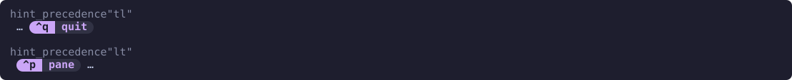

# Fitting the bar

The hint line grows with the number of bindings a mode has, and can easily exceed the terminal. By default the plugin fits it to the available width, dropping whole hints rather than cutting one in half; you choose which ones go, and they can be replaced by an indicator:

```kdl
auto_width      true // default: fit to the bar's pane, or the terminal
reserve_columns 0    // columns to leave beside the hints in zjstatus
max_length      0    // hard cap; 0 = none
```

Where the width comes from depends on how the bar is shown:

- In a pane of its own, the bar fits that pane's width as Zellij reports it, and re-fits when the pane is resized. Nothing else shares the pane, so the whole width goes to the hints and `reserve_columns` is not used.
- Feeding zjstatus, the bar is loaded with `load_plugins` and runs in a hidden pane whose size has nothing to do with the status bar, so it measures the terminal from Zellij's pane geometry instead: the right edge of the widest visible tiled pane. Floating and suppressed panes are ignored, as neither tracks the terminal's real width. Until the first pane update arrives no width is assumed, so nothing is cut on a guess.

`reserve_columns` keeps room for whatever shares zjstatus's bar, and applies only when feeding zjstatus. The plugin cannot see zjstatus's `format_right`, so if you have one, reserve roughly its width:

```kdl
format_left  "{pipe_zjhints}"
format_right "{command_user}@{command_host}:{session}" // about 30 columns
```

```kdl
reserve_columns 32
```

`max_length` acts as a hard cap alongside this. With both set the smaller wins, so an explicit cap is never exceeded on a wide terminal. Set `auto_width false` to ignore the pane and the terminal entirely and use the fixed cap alone.

## Glyph width

Fitting depends on measuring how many columns the hints occupy, which is not the same as counting characters: a CJK ideograph or an emoji takes two.

Nerd Font glyphs are East Asian Ambiguous: one column by the Unicode standard, but two in a terminal actually set up to display them. If you use them in `key_alias_*` or `mod_alias_*` and the hints overflow slightly, so that fitting looks right on wide windows and breaks near the edge, set:

```kdl
ambiguous_width 2
```

Getting this wrong under-counts every such glyph, so the plugin believes the line fits while the terminal wraps or clips it.

## What gets dropped

[hint_order](ordering.md#hint-order) decides what survives. Unpinned hints, the ones inside the `*` that you never spoke for, are given up first, starting with the rightmost:

```kdl
hint_order "*, exit" // exit outlives the hints in the "*"
```

So on a narrowing window the middle thins out while `exit` stays put, rather than `exit` being the first thing over the edge.

> [!NOTE]
> The images on this page use `color_theme "catppuccin-mocha"`, `format_theme "pills"` and `alias_theme "unicode"`. Without them the bar has Zellij's colors and key names such as `Ctrl p`. See [Themes](themes.md).

Here is Normal mode with `hint_order "*, quit"` and `drop_indicator "…"`, at four widths:


When the `*` runs out, dropping continues outward from that same gap: the leading group is consumed from its inner edge, then the trailing group from its inner edge. Hints given up therefore always form one contiguous run, so a single indicator can stand for all of them:

```text
new close split float frames pin exit   <- everything fits
new close split … exit                  <- the "*" thinning out
new … exit                              <- leading group being consumed
… exit                                  <- trailing group is last to go
```

Dropping from the far ends instead would open a second gap and need a second indicator.

A single hint wider than the whole bar survives this and is cut with `overflow_str` as a last resort. Like `drop_indicator`, it is a format string, so `overflow_str "#[fg=$gray]…"` styles the marker.

### Which pinned group goes first

`hint_precedence` names the pinned groups in the order they are held onto, reading like zjstatus's `format_precedence`:

```kdl
hint_precedence "tl" // default: trailing kept, leading spent first
hint_precedence "lt" // leading kept, trailing spent first
```

With the default, a hint pinned to the end outlives one pinned to the front:

```kdl
hint_order      "new, *, exit"
hint_precedence "tl"
```

```text
new … exit   <- the "*" is gone
… exit       <- "new" spent
exit         <- trailing group is last
```



Reverse it with `"lt"` if the hints you pin to the front are the ones you most want kept. Either way the dropped hints stay one contiguous run, so a single `drop_indicator` still covers them. The `*` is always spent first, whichever precedence is set.

## Marking the gap

`drop_indicator` is rendered in place of the dropped run:

```kdl
drop_indicator "#[fg=$gray]…"
```

It is a format string like `hint_spacer`, so it can be styled, and it is spaced like a hint so it reads as one. It costs columns of its own, which come out of the same budget: a wide indicator forces one more hint to drop rather than pushing the line over the limit.

Left unset, hints are dropped silently, unless [`mouse`](mouse.md#hints-that-did-not-fit) is on: then the gap is marked with `…`, which opens a menu of the dropped hints when clicked.
