# Mouse

With `mouse` on, the bar works like the one Zellij ships: right-click it for Zellij's context menu, and left-click a hint to do what its keys do.

```kdl
mouse true
```

It is off by default, because it needs permissions a bar that only shows hints has no reason to ask for (see [Permissions](#permissions)).

Mouse support needs the plugin in [a pane of its own](../README.md#option-a-its-own-pane). Piped into zjstatus, the hints are drawn by zjstatus and the clicks go to zjstatus, so `mouse` does nothing there.

## Right-click

Right-clicking anywhere on the bar opens Zellij's context menu for the bar, the same one the built-in status bar opens. Its items come from the `bar` section of Zellij's own `context_menu` block, not from this plugin:

```kdl
context_menu {
    bar {
        item "New pane" { NewPane; }
        item "New tab" { NewTab; }
    }
}
```

The bar offers no item of its own there. To open the settings screen from it, add the item in [Settings screen](settings.md#from-the-right-click-menu).

## Left-click

A hint is a button. Clicking anywhere on it, keys or description, runs what its keys are bound to in the current mode, in order, as if one of them had been pressed. A key bound to `MessagePlugin "autolock"; SwitchToMode "Normal"` runs both.

Some hints stand for keys that do different things: `focus` covers `h`, `j`, `k` and `l`, each moving a different way. Clicking one of those opens a menu at the mouse with an entry for each distinct thing its keys do, named by the keys and the action:

```text
h←  move focus left
j↓  move focus down
k↑  move focus up
l→  move focus right
```

Choosing an entry runs it, and dismissing the menu runs nothing. Keys that do the same thing share an entry, so a hint whose keys all do one thing, like `close` on both `x` and `q`, runs it straight away with no menu.

Only the keys the hint shows count. With [`direction_keys arrows`](ordering.md#direction-keys), clicking `focus` offers the arrows and not `hjkl`.

Clicking the mode prefix opens the [settings screen](settings.md#by-clicking-the-mode-prefix). The spacers between hints and the empty end of the line do nothing when clicked.

## Hints that did not fit

When the bar is too narrow for every hint, the ones it [drops](fitting.md) are still a click away. The [drop indicator](fitting.md#marking-the-gap) opens a menu of the hints it stands for, one entry per hint, written the way the bar would have shown it. Choosing one is the same as clicking that hint: it runs, or opens its own menu if its keys do different things.

With `mouse` on and no `drop_indicator` set, the gap is marked with `…` so there is something to click. Set `drop_indicator` to use a marker of your own.

When even a single hint does not fit and the line is cut short, `overflow_str` opens the same kind of menu. It lists the hint the cut went through and everything after it, dropped hints included. The part of the cut hint still showing can be clicked as usual.

## Hover preview

Resting the pointer on a hint that would open a menu when clicked shows what the menu offers, in a small read-only popup beside the bar. The popup lists the same entries, written the same way, so you can see what a hint such as `focus` covers before you click it.

```text
┌──────────────────────┐
│ h←  move focus left  │
│ j↓  move focus down  │
│ k↑  move focus up    │
│ l→  move focus right │
└──────────────────────┘
```

The image shows the preview of the [drop indicator](fitting.md#marking-the-gap) on a bar in pane mode, which lists the hints that did not fit:



The popup appears for a hint whose keys do different things, for the [drop indicator](fitting.md#marking-the-gap), and for `overflow_str`. A hint that runs one thing when clicked, the mode prefix, the spacers and the rest of the line show nothing.

It opens below the bar, or above it when the bar is at the bottom of the screen, and never takes the focus. Moving the pointer to a different hint or off the picker hints closes it, and so does clicking the hint, which then opens the real menu. The popup stays open while the pointer rests on it. It closes by itself when the pointer leaves it, and a few seconds after it opens if the pointer never reached it, so a pointer that leaves the bar for another pane cannot strand it.

The popup is this plugin again, opened in a mode that only draws the entries. It asks for no permissions of its own.

## While descended into a nested session

While you are [descended into a nested session](nested-sessions.md#while-descended-into-a-nested-session), the bar shows that session's hints, or a "return to host" indicator until it has sent them. Their keys mean something to the nested session, not to the one this plugin runs in, so by default neither can be clicked. Right-click still opens the context menu.

Turn on `mouse_nested` as well to make them clickable:

```kdl
mouse true
mouse_nested true
```

A click then types the hint's key into the nested session's pane, exactly as pressing it would, rather than running anything in this session. Hints whose keys do different things open the same menu as above, and choosing an entry types one of that entry's keys. Clicking "return to host" types the nested session's ascend keys, which it acts on by returning you to the host.

Keys are sent the way the nested session's pane expects them: re-encoded by Zellij for a pane using the kitty keyboard protocol, which Zellij asks for, and as plain terminal bytes otherwise. A few keys, such as Caps Lock, have no plain encoding and do nothing in a pane that does not use the kitty protocol.

## Permissions

`mouse_nested` needs no permission of its own. Turning `mouse` on asks for two permissions on top of the ones the plugin always needs:

| Permission | Used for |
| --- | --- |
| Run actions as the user | Running a clicked hint's actions |
| Open terminals or plugins | Showing the menus, which are Zellij prompts |

Opening Zellij's context menu and the hover preview also use the permission to change application state, which the plugin always asks for to add the [settings screen](settings.md#from-zellijs-settings-menu) to Zellij's own settings menu.

Zellij asks once, in the plugin's pane, and remembers the answer. Turning `mouse` on after the plugin was already granted its usual permissions asks again for the new ones.

## Zellij support

Right-click and the menus use the context menu and prompt APIs from [#5685](https://github.com/zellij-org/zellij/pull/5685), an open Zellij pull request, so `mouse` needs a Zellij build that includes it. See [Zellij support](../README.md#zellij-support).
