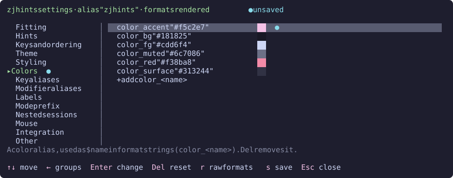

# Settings screen

The settings screen is a floating pane for changing zjhints options without editing the config file by hand. It sorts every option into the same groups as the [configuration reference](configuration.md), previews each change on the running bars as you make it, and writes the result to your config file when you save.

It needs the Zellij build zjhints is compiled against, [fork-v0.46.4](https://github.com/myah-mitchell/zellij/releases/tag/fork-v0.46.4). It edits the config through plugin APIs that are not in a released Zellij yet (see [Zellij support](../README.md#zellij-support)).

## Prerequisites

- zjhints is defined as an alias in your config's `plugins {}` block, as in the [installation example](../README.md#installation). The screen edits that alias, so options set only in a layout are not shown and not changed.
- Your config is loaded from a file Zellij can write to.

## Opening it

There are three ways in. Each one starts a separate zjhints instance with `settings true`, which draws the screen instead of a bar.

### From a keybinding

Add a binding that launches the alias with `settings true`. This example binds `Alt ,` in every mode but locked; pick any free key:

```kdl
keybinds {
    shared_except "locked" {
        bind "Alt ," {
            LaunchOrFocusPlugin "zjhints" {
                floating true
                move_to_focused_tab true
                settings true
            }
        }
    }
}
```

Pressing it again while the screen is open focuses it rather than opening another.

### From the right-click menu

With [`mouse`](mouse.md) on, add an item to the `bar` section of Zellij's `context_menu` block. Right-clicking the bar then offers it:

```kdl
context_menu {
    bar {
        item "zjhints settings" {
            LaunchOrFocusPlugin "zjhints" {
                floating true
                move_to_focused_tab true
                settings true
            }
        }
    }
}
```

### By clicking the mode prefix

With `mouse` and [`show_mode`](nested-sessions.md#standing-alone) on, left-click the mode prefix at the start of the bar. No config is needed for this one. While descended into a nested session the prefix opens it only with [`mouse_nested`](mouse.md#while-descended-into-a-nested-session) on, like the rest of the bar. The screen opens on the alias that bar was started from, and clicking again while it is open brings it back up instead of opening a second one.

## Choosing the alias

The screen edits an alias whose plugin location contains `zjhints`. With one such alias it edits that one. With several, the sidebar starts with *Alias*, whose one row names the alias being edited; **Enter** on that row steps to the next one, once the edits to the current one are saved or discarded.

To open the screen on a particular alias, add `alias` to the launch:

```kdl
LaunchOrFocusPlugin "zjhints" {
    floating true
    settings true
    alias "zjhints-nested"
}
```

## Editing

The screen has two sides. The sidebar on the left lists the groups, the same ones as the [configuration reference](configuration.md), with *Other* last. The list on the right shows the options of the group selected in the sidebar. A group holding unsaved edits is marked with `●` in the sidebar.

Each row of the list shows an option and its value. An option you have not set shows its default, dimmed. When the selected [theme](themes.md) sets that option, the theme's value shows instead, dimmed and followed by *(theme)*. A value you have changed but not saved is marked with `●`. Text values are quoted, so their spaces show; true/false values, numbers and fixed choices are not. The line under the list describes the selected option and its default.

| Key | What it does |
| --- | --- |
| `Tab`, `←` `→`, `h` `l` | Move between the sidebar and the list |
| `↑` `↓`, `k` `j` | Move between groups in the sidebar, or between options in the list |
| `PageUp` `PageDown` | Move a screen at a time |
| `Home` `End`, `g` `G` | Move to the first or last row |
| `Enter` or `Space` | In the sidebar, move to the list; in the list, toggle a true/false option, step through a fixed set of values, or start typing a value |
| `Del`, `Backspace` or `d` | Reset the option to its default by removing it from the alias |
| `r` | Switch format strings between rendered and raw |
| `s` | Save; `Ctrl s` also works in locked mode, where Zellij does not take it for scroll mode |
| `Esc` or `q` | Close, asking first when there are unsaved edits |

While typing a value, **Enter** sets it and **Esc** cancels. Numbers are checked before they are accepted, so `max_length` takes only a whole number and `dim_strength` only a number from 0.0 to 1.0. An empty number resets it; an empty text value is kept, because an empty label hides its hint.

With the mouse, click a group in the sidebar to show it. Click a row in the list to select it and click it again to change it. The scroll wheel scrolls the side under the pointer without moving the selection.

### In a narrow pane

When the pane is too narrow for the sidebar beside the list, a line over the list names the group shown instead, between arrows. **←** and **→** (or **h** and **l**, or **Tab** for the next one) step through the groups, and clicking the line does the same: the arrow at its start for the previous group, anywhere else for the next.

### Format strings

Format strings, such as `key_format`, `mode_format_locked` and `hint_spacer`, are shown rendered: drawn as the bar draws them, colors included, with sample values in the placeholders. A `$name` color resolves the way the bar resolves it, from your own `color_<name>` or else from the selected theme. `{key}` shows `Ctrl p`, spelled with your modifier aliases, `{desc}` shows `Pane`, and `{mode}` shows the mode's name, such as `NORMAL`. A format string that draws nothing visible is shown as written instead.

The *Styling* group below shows `key_format` and `key_format_quit` as the blocks the bar draws, and an edit to `desc_format`, marked with `●`, in the selected row:


Press **r** to show every format string as written, and again to go back. The title says which way they are shown, as *formats rendered* or *formats raw*. Editing always starts from the text as written.

### Colors

A value that is a hex color, as in `#89b4fa`, or a `$name` alias whose `color_<name>` is one, has a swatch of that color drawn after it. The alias can be one of yours or one the selected theme defines.



### Keys outside the fixed options

Keys that are not single options, such as `label_<id>`, `key_format_<id>` and `color_<name>`, are listed in the group their family belongs to: `color_blue` under *Colors*, `label_split_down` under *Labels*. What each family is for is shown under the list. Edit them like any other row, and press **Del** on one to remove it.

Each group with families ends in a line per family to add a key, such as *+ add color_\<name\>*. Select it and press **Enter**, and the key starts with the family's prefix: type the rest, press **Enter**, then type its value.

*Other* lists the keys that fit no group, which zjhints does not read. Its *+ add a key* line starts the key empty, and a key you add there that fits a group is listed in that group.

## Previewing and saving

Every change shows on the bars started from the alias as soon as you make it. Nothing is written until you press **s**, which saves the alias to your config file. Only the keys you changed are rewritten, so the file's comments and layout stay as they were.

If the file changed on disk since Zellij read it, saving stops and asks: **o** overwrites the file with your edits, **r** reloads it and drops them, and the bars go back to the file's values.

Closing with **Esc** and choosing to discard puts the bars back to the saved values.

### What a preview reaches

- Bars started from the alias being edited. A bar started from another alias, or from a plugin location rather than an alias, is left alone.
- Bars in this session only. Other sessions pick the saved values up when they start.
- Keys the alias controls for that bar. A key a layout sets on the bar's own pane, such as `show_mode true`, stays as the layout sets it through every later change to it.

A bar loaded with `load_plugins` to feed zjstatus runs in a hidden pane of its own, so previews reach it by alias like any other bar.

Closing the screen pane any way other than **Esc** or **q**, such as with Zellij's close-pane key, leaves unsaved previews on the bars until the session restarts.

## Permissions

The screen asks for permission to change the configuration and to message other plugins, the latter to send its previews. It also asks for everything a bar can use, [mouse permissions](mouse.md#permissions) included. Zellij keeps one grant for the screen and the bars, because they load from the same file, and each grant replaces the last; asking for the lot keeps opening the screen from taking permissions away from the bars.

A bar granted its own, smaller set afterwards replaces the screen's grant in turn, so the screen can ask again the next time it opens. It is a floating pane, so the prompt can always be answered there.

The bar asks for nothing new for the screen: clicking the mode prefix uses the permission to message plugins the bar already holds. Turning `mouse` on from the screen makes a running bar ask for the mouse permissions, as it would when started with `mouse true`.
