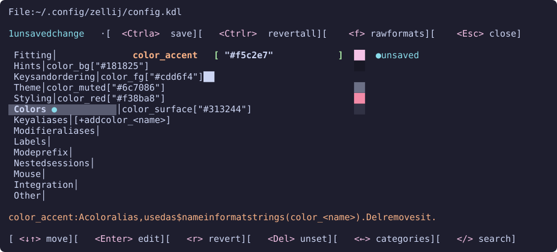

# Settings screen

The settings screen is a floating pane for changing zjhints options without editing the config file by hand. It sorts every option into the same groups as the [configuration reference](configuration.md), previews each change on the running bars as you make it, and writes the result to your config file when you save.

It needs the Zellij build zjhints is compiled against, [fork-ea-v0.46.7-261103](https://github.com/myah-mitchell/zellij/releases/tag/fork-ea-v0.46.7-261103), or the next Zellij release. It edits the config through plugin APIs that are merged into Zellij but not in a release yet (see [Zellij support](../README.md#zellij-support)).

> [!NOTE]
> Every plugin in this repository shares this screen, and the text below says zjhints where it means whichever one you are editing. For zjtabs or zjtaskbar, use its name in the launch examples and look for its entry on Zellij's settings screen. Their groups are in the [zjtabs](zjtabs/configuration.md) and [zjtaskbar](zjtaskbar/configuration.md) configuration references.

## Prerequisites

- zjhints is defined as an alias in your config's `plugins {}` block, as in the [installation example](installation.md#example-configuration). The screen edits that alias, so options set only in a layout are not shown and not changed.
- Your config is loaded from a file Zellij can write to.

## Opening it

There are four ways in. Each one opens a floating pane that loads zjhints with `settings true`, which draws the screen instead of a bar. The pane joins the bars' [shared instance](shared-instances.md), which is how the bars receive its previews. A bar that sets `instance` needs the screen opened with the same value; see [Opening the settings screen](shared-instances.md#opening-the-settings-screen).

The screen opens pinned, so it stays on screen while you click into other panes and type there, and the bars it previews on stay in view beside it. Clicking it again gives it the keyboard back. To let it hide with the other floating panes, unpin it from Zellij's pane menu.

### From Zellij's settings screen

Open Zellij's own settings screen and go to its *Plugins and environment* page. Each running bar adds a *zjhints* entry under *Plugin settings*; select it to open this screen on the alias that bar was started from. No config is needed for this one.

Bars started the same way, such as one per tab from the same alias, share one entry. Bars started from different aliases each add their own, all titled *zjhints*.

### From a keybinding

Add a binding that launches the alias with `settings true`. This example binds `Alt ,` in every mode but locked; pick any free key:

```kdl
keybinds {
    shared_except "locked" {
        bind "Alt ," {
            LaunchOrFocusPlugin "zjhints" {
                floating true
                move_to_focused_tab true
                settings true
            }
        }
    }
}
```

Pressing it again while the screen is open focuses it rather than opening another.

### From the right-click menu

With [`mouse`](mouse.md) on, add an item to the `bar` section of Zellij's `context_menu` block. Right-clicking the bar then offers it:

```kdl
context_menu {
    bar {
        item "zjhints settings" {
            LaunchOrFocusPlugin "zjhints" {
                floating true
                move_to_focused_tab true
                settings true
            }
        }
    }
}
```

### By clicking the mode prefix

With `mouse` and [`show_mode`](nested-sessions.md#standing-alone) on, left-click the mode prefix at the start of the bar. No config is needed for this one. While descended into a nested session the prefix opens it only with [`mouse_nested`](mouse.md#while-descended-into-a-nested-session) on, like the rest of the bar. The screen opens on the alias that bar was started from, and clicking again while it is open brings it back up instead of opening a second one.

A zjtabs bar does the same with `mouse` on, and its `show_mode` is on by default, so its prefix is there to click with no config at all. See [Opening the settings screen](zjtabs/mouse.md#opening-the-settings-screen).

A zjtaskbar bar has no mode prefix, but the `mode` item of its tray does the same with `mouse` on. The tray is empty by default, so add `mode` to `tray` first. See [The items](zjtaskbar/tray.md#the-items).

## Choosing the alias

The screen edits the aliases that load the same plugin file it runs from, which is the file of the bar that opened it. The alias names and file name don't matter. With one such alias it edits that one. With several, the menu starts with *Alias*, whose one row is a dropdown of them; pick another there once the edits to the current one are saved or reverted.

To open the screen on a particular alias, add `alias` to the launch:

```kdl
LaunchOrFocusPlugin "zjhints" {
    floating true
    settings true
    alias "zjhints-nested"
}
```

## The screen

The screen is laid out like Zellij's own settings screen, and takes the same core keys, with a few of its own for zjhints.

- The top line names the config file. Under it, the count of unsaved changes is followed by buttons for saving, reverting, switching how format strings are shown, and closing. Click a button or press the key it names.
- The menu on the left lists the groups, the same ones as the [configuration reference](configuration.md), with *Other* last. A group holding unsaved changes is marked with `●`.
- The rows on the right are the options of the group selected in the menu. Each row is a widget: a toggle for a true/false option, a dropdown for a fixed set of values, and a text field for anything else.
- The line under the rows describes the selected option and its default. The bottom line is a row of buttons for the keys that work right now. Click one or press the key it names.

After each value comes a marker of where it comes from:

| Marker | Meaning |
| --- | --- |
| *● unsaved* | Changed from the config file and not saved yet |
| *○ default* | Not set, so the field shows the built-in default, dimmed |
| *○ theme* | Not set, so the field shows the value the selected [theme](themes.md) gives it, dimmed |
| *✗ ignored* | A key the bar does not read: it starts like a family's keys but fits none, as in [Keys that fit no family](#keys-that-fit-no-family) |
| None | Set in the config file and unchanged |

Text values are quoted, so their spaces show; true/false values, numbers and fixed choices are not. A control character in a key or value is shown as an escape, such as `\u{1b}` for ESC or `\n` for a newline, rather than sent to the terminal. So is a character that reorders text, such as `\u{202e}`.

The screen needs a pane of at least 50 columns by 12 rows. A smaller one shows how much it needs instead.

## Editing

### In the menu

| Key | What it does |
| --- | --- |
| `↑` `↓`, or `k` `j` | Show the previous or next group |
| `Tab`, `→` or `Enter` | Move to the rows |
| `/` | Search every group |
| `Esc` | Close |

### In the rows

| Key | What it does |
| --- | --- |
| `↑` `↓`, `k` `j`, `Tab` | Move between rows |
| `Shift Tab` | Move up, and to the menu from the first row |
| `PageUp` `PageDown`, `Home` `End` | Move a screen at a time, or to the first or last row |
| `Space` | Flip a toggle or open a dropdown |
| `Enter` | Start typing into a text field, flip a toggle or open a dropdown |
| `←` `→` | On a dropdown, step to the previous or next value; elsewhere, `←` goes back to the menu |
| `r` | Revert the option to the config file's value |
| `Del` or `Backspace` | Unset the option, so its default applies; a key outside the fixed options is removed |
| `/` | Search every group |
| `Esc` | Close, or end the search while searching |

In an open dropdown, `↑` and `↓` move through the values, `Enter` or `Space` picks one, and `Esc` closes it unchanged.

While typing into a field, `Enter` applies the value and `Esc` cancels. Numbers are checked before they are accepted, so `max_length` takes only a whole number and `dim_strength` only a number from 0.0 to 1.0. An empty number unsets it; an empty text value is kept, because an empty label hides its hint.

### Everywhere

| Key | What it does |
| --- | --- |
| `Ctrl a` | Save |
| `Ctrl r` | Revert every unsaved change, after asking |
| `f` | Switch format strings between rendered and raw |
| `o` | In the *Theme* group, show or hide your overrides in the preview |

`Ctrl a` and `Ctrl r` do nothing while you are typing into a field. `f` and `o` are typed as text in a field or the search box.

### With the mouse

Click a group in the menu to show it. Click a row to select it and act on it: a toggle flips, a dropdown opens, and a text field starts taking typing. Click outside a field you are typing into to cancel it. The buttons along the bottom work while you type or choose from a dropdown too, and the one for `↓` `↑` moves down. The scroll wheel scrolls the menu or the rows, whichever is under the pointer.

## Searching

Press `/` to search. The search box takes the menu's place, and the rows show every option and key from every group whose name matches, under the name of its group. The match is fuzzy: the letters you type have to appear in order, not next to each other, and case is ignored.

Press `↓` to move from the search box to the results, and `↑` on the first result to go back. Changes made from the results keep them on screen. `Esc` in the box clears the search text, and a second `Esc` ends the search.

## Format strings

Format strings, such as `key_format`, `mode_format_locked` and `hint_spacer`, are shown rendered: drawn as the bar draws them, colors included, with sample values in the placeholders. A `$name` color resolves the way the bar resolves it, from your own `color_<name>` or else from the selected theme. In a hint's format, `{key}` shows `Ctrl p`, spelled with your modifier aliases, and `{desc}` shows `Pane`. In a mode format, `{mode}` shows the mode's name, such as `NORMAL`, and `{desc}` and `{key}` show that mode's `mode_label_<mode>` and `mode_key_<mode>` as the bar draws them. A format string that draws nothing visible is shown as written instead.

The *Styling* group below shows `key_format` and `key_format_quit` as the blocks the bar draws, an unsaved edit to `desc_format` that makes its description italic, and `hint_spacer` on the selected row:

![The settings screen on the Styling group. The header shows 1 unsaved change and the save, revert all, raw formats and close buttons. The menu lists the groups from Fitting to Other with Styling selected and marked, and the rows show key_format as a light purple Ctrl p block, desc_format as italic Pane marked unsaved, hint_spacer as a vertical bar on the selected row, drop_indicator unset with its default and key_format_quit as a pink Ctrl p block, followed by buttons to add keys. The key help runs along the bottom](img/settings-styling.svg)

Press `f` or click its button to show every format string as written, and again to go back. The button says which way pressing it switches. Typing into a field always starts from the text as written.

## Colors

A value that is a hex color, as in `#89b4fa`, or a `$name` alias whose `color_<name>` is one, has a swatch of that color drawn after it. The alias can be one of yours or one the selected theme defines.



## Theme preview

The *Theme* group draws a bar under its three options, as your bars would draw it with the themes selected there. It uses the session's current mode, keybindings and Zellij theme, so `color_theme zellij` shows the colors you have now. While a theme's dropdown is open, the preview follows the value highlighted in it. Options that hide the whole bar, such as `hidden`, are left out of the preview.

A zjtaskbar preview draws the launcher's button, then as many of six sample floating panes as fit, with markers for the rest, then the tray at the right end once you list items in it. The panes include a focused one, a minimized one and two in another tab, and follow your `pane_scope`. Its clock shows a fixed time, 09:41 UTC in your `clock_format`, moved by `clock_utc_offset` when you set one, so the preview runs no command to learn the time and stays the same while you watch it.

Any key you set that a selected theme sets too, such as `color_accent` or `desc_format`, overrides the theme. The caption over the bar counts them. Press `o`, or click the button beside the caption, to draw the bar without them and see the themes on their own; press it again to put them back. Hiding them changes only the preview, not your settings.

## Keys outside the fixed options

Keys that are not single options, such as `label_<id>`, `key_format_<id>` and `color_<name>`, are listed in the group their family belongs to: `color_blue` under *Colors*, `label_split_down` under *Labels*. What each family is for is shown under the rows. Edit them like any other row, and press `Del` on one to remove it.

Each group with families ends in a button per family to add a key, such as *+ add color_\<name\>*. Click it, or select it and press `Enter`, and the key starts with the family's prefix: type the rest, press `Enter`, then type its value.

Families whose keys start alike each have a button of their own. zjtaskbar's *Launcher* group has one per field of a launcher entry, from *+ add launch_\<n\>_name* to *+ add launch_\<n\>_config_\<key\>*, after a *+ add launch entry* button that starts a new entry.

*Other* lists the keys that fit no group, which zjhints does not read. Its *+ add a key* button starts the key empty, and a key you add there that fits a group is listed in that group.

### Launcher entries

An entry takes one key per field, all with the same number, such as `launch_3_name` and `launch_3_command`. The buttons fill the number in, so you never type it:

1. Click **+ add launch entry**. The key starts as the next entry's name, numbered one past the highest entry set, such as `launch_3_name`.
2. Press `Enter` and type the entry's name.
3. Click a field's button, such as **+ add launch_\<n\>_command**. The key starts with the same number, as `launch_3_command`.
4. Press `Enter` and type the field's value. Repeat for the entry's other fields.

The field buttons number a key for the entry you last changed a key of, or the highest-numbered entry when you have changed none, so change a key of another entry first to add fields to it. You can also edit the number before pressing `Enter`. The number is a whole number written without leading zeros, as the launcher reads it. *+ add launch_\<n\>_config_\<key\>* starts the key as far as `config_`, such as `launch_3_config_`, for you to type the plugin's own key.

### Keys that fit no family

A key that starts like a family's keys but fits none of them is listed in that family's group and marked *✗ ignored*, since the bar does not read it. Examples are a misspelled `launch_1_nmae`, an entry numbered `launch_01_name`, and `mode_label_bogus`, whose last word is no mode. The line under the rows names the keys it could have been, such as `launch_<n>_*` for the fields of a launcher entry. Add the key you meant, then select the ignored one and press `Del` to remove it.

## Previewing and saving

Every change shows on the bars started from the alias as soon as you make it. Nothing is written to the file until you press `Ctrl a` or click the save button. Only the keys you changed are rewritten, so the file's comments and layout stay as they were.


`r` reverts the selected option, and `Ctrl r` reverts them all after asking. The question highlights *Cancel*, so `Enter` keeps your changes. A revert puts the bars back to the file's values too.

If the file changed on disk since Zellij read it, saving stops and asks what to do. *Cancel* is highlighted, so `Enter` or `Esc` changes nothing:

- **Cancel** keeps your changes unsaved.
- **Overwrite** writes your changes over the file.
- **Reload** takes the file as it is and drops your unsaved changes; the bars go back to the file's values.

### Closing with unsaved changes

Closing does not discard anything, as in Zellij's own settings screen. Unsaved changes stay applied to the bars running in the session, and a notice says so for a moment before the screen closes. Open the screen again and press `Ctrl a` to save them, or `Ctrl r` to drop them. Closing the pane any other way, such as with Zellij's close-pane key, keeps them the same way.

A bar started later in the session, such as one in a new tab, starts from the alias as the session loaded it, without the unsaved changes. It joins the instance with its own options and doesn't take the previews the other bars are showing.

### What a preview reaches

- Bars started from the alias being edited. A bar started from another alias, or from a plugin location rather than an alias, is left alone.
- Bars in this session only. Other sessions pick the saved values up when they start.
- Bars in the screen's own instance. A bar that sets a different `instance` is left alone.
- Keys the alias controls for that bar. A key a layout sets on the bar's own pane, such as `show_mode true`, stays as the layout sets it through every later change to it.

A bar takes a preview only from a pane of its own instance, such as the settings screen. A preview sent by another plugin, another instance, `zellij pipe` or a keybinding changes nothing. No other plugin can change a bar's options this way, such as the commands zjtaskbar's launcher runs.

A bar loaded with `load_plugins` to feed zjstatus runs in a hidden pane of its own, so previews reach it by alias like any other bar.

Unsaved changes last until the session ends. They never reach the config file, so a new session starts from the saved values.

## Permissions

When it first draws, the screen asks for permission to change the configuration and to message other plugins, the latter to send its previews. Its questions, such as the one before reverting everything, are shown by Zellij in a prompt of its own, which needs the permission to open panes that the mouse permissions include. It also asks for everything a bar can use, [mouse permissions](mouse.md#permissions) included. For zjtaskbar that takes in *Run commands*, which its clock and its launcher entries use, though the screen itself runs no command. The screen and the bars are one instance, so Zellij keeps one grant for them. Each request carries everything the instance has been granted or asked for so far, one prompt at a time, so opening the screen never takes a permission from the bars, and a bar's later request never takes one from the screen. Denying a prompt takes the grant from the screen and every bar. The screen is a floating pane, so the prompt can always be answered there.

The bar asks for permission to change application state so it can add its entry to Zellij's settings screen, and opening the screen from that entry or the mode prefix uses the permission to message plugins it already holds. Turning `mouse` on from the screen makes a running bar ask for the mouse permissions, as it would when started with `mouse true`.
