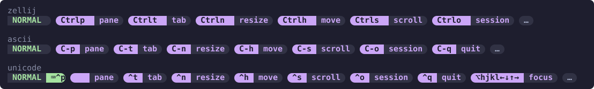

# Themes

Themes restyle the bar without writing format strings. There are three kinds, and each can be picked on its own:

| Option | What it sets |
| --- | --- |
| `color_theme` | The palette: color aliases such as `$accent` and `$surface` |
| `format_theme` | The shape: how keys, descriptions and the mode prefix are drawn, using those aliases |
| `alias_theme` | The symbols: what modifiers, special keys and modes are drawn as |

```kdl
color_theme "catppuccin-mocha"
format_theme "pills"
alias_theme "unicode"
```

## Contents

- [Choosing a theme](#choosing-a-theme)
- [Color themes](#color-themes)
- [Format themes](#format-themes)
- [Alias themes](#alias-themes)
- [Overriding parts of a theme](#overriding-parts-of-a-theme)
- [Using a theme's colors in your formats](#using-a-themes-colors-in-your-formats)
- [Nerd Fonts](#nerd-fonts)

## Choosing a theme

Each of the three options takes `zellij` or a built-in name, and defaults to `zellij`. Names are matched ignoring case and surrounding spaces. A name that is none of these is written to the plugin log and treated as `zellij`.

With all three left at `zellij`, the bar looks the way it does with no theme at all: keys, descriptions and the mode prefix are drawn from the active Zellij theme, as described in [Styling](styling.md). Picking only a `format_theme` gives that shape in your Zellij theme's colors.

## Color themes

A color theme defines eleven color aliases, which the format themes and your own formats refer to.

| Value | Where the colors come from |
| --- | --- |
| `zellij` | The active Zellij theme, followed live when you switch Zellij themes |
| `custom` | Your own `color_<name>` options only |
| `catppuccin-mocha` | [Catppuccin](https://catppuccin.com/palette) Mocha, dark |
| `catppuccin-latte` | Catppuccin Latte, light |
| `dracula` | [Dracula](https://draculatheme.com/contribute), dark |
| `nord` | [Nord](https://www.nordtheme.com/docs/colors-and-palettes), dark |
| `gruvbox-dark` | [Gruvbox](https://github.com/morhetz/gruvbox#palette) dark, with its bright accents |
| `tokyo-night` | [Tokyo Night](https://github.com/folke/tokyonight.nvim), the night variant |

The same bar in each color theme, drawn with `format_theme "flat"` and `show_mode` on:


Every color theme defines the same aliases, so a format that refers to `$accent` works under any of them:

| Alias | Role | Zellij theme component |
| --- | --- | --- |
| `$bg` | The darkest background, and the text color on bright blocks | `text_unselected` background |
| `$fg` | Body text | `text_unselected` base |
| `$surface` | The block behind descriptions | `text_selected` background |
| `$muted` | De-emphasized text | `table_title` background |
| `$accent` | The theme's signature color, used for keys | `ribbon_selected` background |
| `$red` `$green` `$yellow` `$blue` `$magenta` `$cyan` | The theme's own version of each hue | Exit code, ribbon and text emphasis colors |

Dracula has no blue, so its `$blue` is the same purple as its `$accent`.

`custom` adds no aliases. Use it when you define your own `color_<name>` options and want the config to say so. A format theme used with `custom` refers to `$bg`, `$fg`, `$surface`, `$muted`, `$accent` and the six hues, so define those.

## Format themes

A format theme sets `key_format`, `desc_format`, `hint_spacer`, `drop_indicator`, `overflow_str`, `mode_format` and a `mode_format_<mode>` for every mode. Its formats use only the color aliases, so any format theme works with any color theme.

| Value | Shape |
| --- | --- |
| `zellij` | Nothing set: the Zellij-palette default |
| `flat` | The key on an `$accent` block beside the description on a `$surface` block |
| `plain` | Colored text with no blocks: the key in `$accent`, bold, then the description |
| `powerline` | The flat blocks, each ending in a Powerline arrow |
| `pills` | Each hint a rounded pill, the key at its left end on `$accent` |

The same bar in each format theme, in `catppuccin-mocha` colors:


The mode prefix is colored by mode, the same in every format theme:

| Color | Modes |
| --- | --- |
| `$green` | `normal`, `tmux` |
| `$red` | `locked` |
| `$yellow` | `resize`, `move` |
| `$blue` | `pane`, `rename_pane` |
| `$magenta` | `tab`, `rename_tab`, `session`, `rename_session` |
| `$cyan` | `scroll`, `search`, `enter_search` |
| `$accent` | `prompt` |

A mode with a symbol, from an [alias theme](#alias-themes) or your own `mode_key_<mode>`, draws it with its name: before the name in most shapes, and in a block of its own after the name in `pills`. A mode without one gets the name alone.

A format theme leaves `show_mode` off until you turn it on, so the mode prefix only appears when you ask for it. Its `drop_indicator` marks the gap where hints were dropped to fit, drawn in the theme's shape, whether or not `mouse` is on. Its `overflow_str` ends a hint cut short in the same shape. The per-hint `key_format_<id>` and `desc_format_<id>` options keep their defaults.

## Alias themes

An alias theme sets `mod_alias_<name>` for the four modifiers, `key_alias_<name>` for special keys, and `mode_key_<mode>`, the symbol a mode prefix draws with `{key}`.

| Value | Modifiers | Keys | Modes |
| --- | --- | --- | --- |
| `zellij` | Nothing set | Nothing set | Nothing set |
| `ascii` | `C-` `M-` `S-` `s-` | `RET`, `ESC`, `TAB`, `<` `v` `^` `>` | No symbols |
| `unicode` | `^` `⌥` `⇧` `⌘` | `⏎`, `⎋`, `⇥`, `←` `↓` `↑` `→` | `⌨` normal, `⊘` locked, and one per mode |
| `nerd-font` | Nerd Font Apple-style modifier glyphs | Nerd Font key glyphs | A Nerd Font icon per mode |

The same bar in the `ascii` and `unicode` alias themes, drawn as `catppuccin-mocha` pills:



To use a different symbol for one mode, set `mode_key_<mode>` yourself. To rename a mode, set `mode_label_<mode>`. See [One format for every mode](nested-sessions.md#one-format-for-every-mode).

## Overriding parts of a theme

Your own options always win. A theme only fills in what you left unset, one option at a time:

```kdl
color_theme "nord"
format_theme "flat"
// Recolor one alias, and every format that uses it follows.
color_accent "#ebcb8b"
// Replace one format; the rest of the theme stays.
desc_format "#[fg=$fg,bg=$surface,italic] {desc} "
```

- A `color_<name>` you set replaces that alias only. You can also add aliases of your own.
- A `key_format`, `desc_format`, `mode_format`, `hint_spacer`, `drop_indicator` or `overflow_str` you set replaces the theme's. Per-hint formats such as `key_format_quit` apply to their hint as they do without a theme.
- Setting `mode_format` replaces the prefix for every mode. The format theme's per-mode formats are then left out, so they cannot take priority over it. Set `mode_format_<mode>` yourself to change a single mode.
- A `mod_alias_<name>`, `key_alias_<name>` or `mode_key_<mode>` you set replaces the alias theme's symbol.
- An empty value turns that part of the theme off. `key_format ""` returns the keys to the Zellij palette, and `mode_key_locked ""` drops the locked mode's symbol, while the rest of the theme stays.

In the [resolution order](styling.md#styling-one-hint) for a hint's format, a theme's `key_format` sits where your own global `key_format` would.

## Using a theme's colors in your formats

The aliases are ordinary `color_<name>` options, so any format string can use them:

```kdl
color_theme "tokyo-night"
key_format_quit "#[fg=$bg,bg=$red,bold] {key} "
desc_format_quit "#[fg=$red,bg=$surface] {desc} "
drop_indicator "#[fg=$muted]…"
hint_spacer "#[fg=$muted] │ "
```

Switching to another color theme recolors these as well, since they refer to the aliases rather than to hex values.

## Nerd Fonts

The `powerline` and `pills` format themes and the `nerd-font` alias theme draw glyphs from a [Nerd Font](https://www.nerdfonts.com/). Powerline arrows are U+E0B0, and pill ends are U+E0B6 and U+E0B4. Without a Nerd Font in your terminal these render as empty boxes.

Nerd Font glyphs are East Asian Ambiguous. If your terminal draws them two columns wide, set `ambiguous_width 2` so [fitting](fitting.md#glyph-width) measures the bar correctly.
