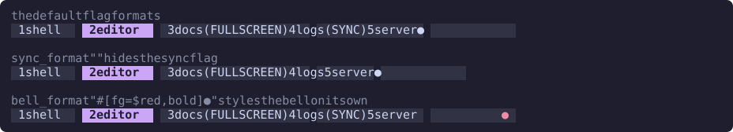
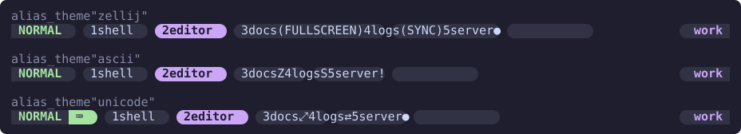

# Tab formats and flags

Each tab is drawn from a format string, and the states worth noticing from the bar, such as a bell, are flags drawn from small formats of their own. This page covers the placeholders, the flags, the gap between tabs, numbering and renaming, for anyone restyling the tabs.

With nothing set, every tab is a ribbon in the Zellij theme's colors, the way Zellij's own tab bar draws it: its number, its name and its flags, with the active tab in the selected ribbon color. The sections below change that one part at a time, or all of it with a [theme](#themes).

## Placeholders

`tab_format` styles every tab but the active one, and `active_tab_format` the active one. Both use the format-string syntax: `#[...]` blocks set the style of what follows, and `$name` refers to a color alias. See [Styling](../styling.md) and [Colors](../styling.md#colors).

| Placeholder | Filled with |
| --- | --- |
| `{index}` | The tab's number, counted from its place in the bar |
| `{name}` | The tab's name |
| `{flags}` | The tab's [flags](#flags) |

```kdl
color_theme "catppuccin-mocha"
tab_format        "#[fg=$fg,bg=$surface] {index} {name}{flags} "
active_tab_format "#[fg=$bg,bg=$accent,bold] {index} {name}{flags} "
```

A format that leaves a placeholder out leaves that part off the tab. A format set to an empty string counts as unset, so the tab is drawn in Zellij's ribbon colors again.

### Names are drawn as text

The name is put into the format after the format has been read, so nothing in a name is taken for styling. A tab named `#[fg=red]build` shows exactly that, and a `$` or a `{` in a name is drawn as typed.

A control character in a name is drawn as an escape, such as `\u{1b}` for ESC, rather than sent to the terminal.

## Numbering

Tabs are numbered from 1, as Zellij numbers them everywhere else, from the `GoToTab` keybinding to the names it gives new tabs. `{index}` is the tab's place in the bar, so it changes when you move a tab.

To count from 0 instead, set:

```kdl
index_from_zero true
```

## Flags

`{flags}` draws one indicator for each state a tab is in, in the order of this table, straight after the name.

| Option | Shown for a tab that | Default |
| --- | --- | --- |
| `fullscreen_format` | Has a pane filling the whole tab | ` (FULLSCREEN)` |
| `sync_format` | Sends what is typed to every pane of the tab | ` (SYNC)` |
| `floating_format` | Shows its floating panes over its tiled ones | ` (FLOATING)` |
| `bell_format` | Has a pane that rang the bell or has something that needs you | ` ●` |

The bell flag also appears for a tab with a program waiting on you, failed or finished, unless you muted that tab's attention in Zellij. A program that is still working does not count. Zellij reports a bell only for a tab that is not active.

Each option is a format string without placeholders. Write the space before the flag yourself, as the defaults do, so the flag does not touch the name. An empty value hides that flag:

```kdl
sync_format ""
```

A flag is drawn in the style of the tab around it, so a symbol sits on the tab's own background. A `#[...]` block in the flag changes only what it sets, such as the color or bold, and the tab's background stays under it:

```kdl
bell_format "#[fg=$red,bold] ●"
```



An alias theme swaps all four flags for symbols at once. See [Themes](#themes).

## Spacing

`tab_spacer` is a format string drawn between neighboring tabs, and between a tab and an [overflow marker](overflow.md#markers). It is one space by default, which keeps ribbons in Zellij's colors from running together. Set it to an empty string for no gap, or to a styled divider:

```kdl
tab_spacer "#[fg=$muted] │ "
```

## Renaming

While you rename a tab, Zellij clears its name and updates it as you type, so the tab shows the new name as it forms. Until the first character, the bar draws `rename_placeholder` in place of the empty name, so the tab does not shrink to nothing. It reads `Enter name...` by default, the text Zellij's own bar shows:

```kdl
rename_placeholder "new name"
```

The placeholder is plain text and appears only on the tab being renamed. Double-clicking a tab starts a rename; see [Mouse](mouse.md#renaming).

## Themes

The three theme options can each be picked on its own, and take the same values as for zjhints. See [Themes](../themes.md). For zjtabs they set:

| Option | What it sets for tabs |
| --- | --- |
| `color_theme` | The color aliases, `$accent` and the rest, exactly as for zjhints |
| `format_theme` | `tab_format`, `active_tab_format`, `tab_spacer`, both overflow markers and `overflow_str` |
| `alias_theme` | The four flag options, as the symbols below |

Your own options always win over a theme, one option at a time.

The same five tabs in each format theme, in `catppuccin-mocha` colors:


| Value | Shape |
| --- | --- |
| `zellij` | Nothing set: ribbons in the Zellij theme's colors |
| `flat` | The index and name on a `$surface` block, the active tab on an `$accent` block in bold |
| `plain` | Colored text with no blocks, two spaces apart: `$muted` for a tab, bold `$accent` for the active one |
| `powerline` | The flat blocks, each ending in a Powerline arrow |
| `pills` | Each tab a rounded pill |

The symbols an alias theme gives the flags:

| Flag | `zellij` | `ascii` | `unicode` |
| --- | --- | --- | --- |
| Fullscreen | `(FULLSCREEN)` | `Z` | `⤢` |
| Sync | `(SYNC)` | `S` | `⇄` |
| Floating | `(FLOATING)` | `F` | `❐` |
| Bell | `●` | `!` | `●` |

The `nerd-font` theme draws Material Design glyphs for the same four: fullscreen, sync, layers and a bell.



The `powerline` and `pills` shapes and the `nerd-font` symbols need a Nerd Font in your terminal. If it draws them two columns wide, set `ambiguous_width 2` so the bar measures them correctly. See [Nerd Fonts](../themes.md#nerd-fonts).
