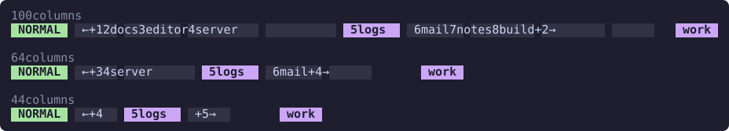
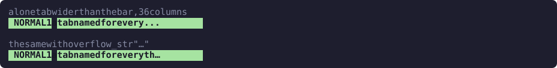

# Overflow

When there are more tabs than the bar is wide, zjtabs shows a window of them around the active tab and replaces the rest with a marker on each side. This page covers how the width is chosen, how the window is picked, the markers, and what happens to a single tab that is too wide on its own.

## Fitting the bar

```kdl
auto_width true // default: fit to the bar's own pane
max_length 0    // hard cap in columns; 0 = none
```

With `auto_width` on, the bar fits the width of its own pane as Zellij reports it, and fits again when the pane is resized. Until Zellij has reported the width, nothing is cut on a guess.

`max_length` is a hard cap alongside it. With both set, the smaller wins, so an explicit cap is never exceeded on a wide terminal. Set `auto_width false` to ignore the pane and use the cap alone. While the [session name](formats.md#session-name) is shown, a cap wider than the pane is still cut at the pane's right edge, so the name stays where you can see it.

The [mode prefix](formats.md#mode-prefix) and the spacer after it take their columns first, then the [session name](formats.md#session-name) and the spacer before it, and the tabs are fitted into what is left. The session name is left off when it would not leave room for the active tab and its markers.

## The window around the active tab

If every tab fits, every tab is shown. Otherwise the window starts as the active tab alone and grows one tab at a time, alternating between the two sides, so the active tab stays near the middle. When one side has nothing left or cannot take its next tab, the other side keeps growing until neither can.

The window is never broken: the tabs shown are always neighbors, so one marker per side can stand for everything hidden there. The active tab is always shown.

Showing the last hidden tab on a side removes that side's marker, which frees its columns. So when the next tab does not fit but all the rest of the side does once its marker is gone, the whole rest of the side is shown.

The same ten tabs in bars of 100, 64 and 44 columns, with the logs tab active, in `flat` blocks:



## Markers

A marker stands for the tabs hidden on its side, and `{count}` is how many.

| Option | Marks |
| --- | --- |
| `overflow_left_format` | The tabs hidden before the ones shown |
| `overflow_right_format` | The tabs hidden after the ones shown |

Left unset, they draw as Zellij's own tab bar does, an arrow and the count in the inactive ribbon color: ` ← +2 ` on the left and ` +3 → ` on the right. A format theme replaces them with markers in its own shape.

Set your own as for any other format, with `{count}`:

```kdl
overflow_left_format  "#[fg=$muted]‹{count} "
overflow_right_format "#[fg=$muted] {count}›"
```

A marker is separated from its neighbors by `tab_spacer`, like a tab. See [Spacing](formats.md#spacing).

With `mouse` on, clicking a marker switches to the nearest hidden tab on its side. See [Markers](mouse.md#markers).

## A tab too wide to fit

When even the active tab with its markers is wider than the bar, the markers are left out and the active tab is shown alone, cut at the bar's edge and ending in `overflow_str`. A cut never splits a character, so the line can stop a column short.

```kdl
overflow_str "..." // default
```

`overflow_str` is a format string, so it can be styled or a single glyph such as `…`. The default matches zjhints, so the two bars cut alike, and a format theme sets its own.



The part of the cut tab still showing can be clicked as usual. The `overflow_str` itself stands for nothing.

## Glyph width

Fitting measures how many columns the tabs occupy, which is not the same as counting characters. The bar measures text the way Zellij lays out a plugin's pane, one grapheme cluster at a time: an emoji built from several characters takes two columns, and an East Asian Ambiguous character, such as a Nerd Font glyph, takes one whatever the terminal draws. A tab cut to fit loses a cluster that would cross the edge whole. See [Glyph width](../fitting.md#glyph-width) for the details.
